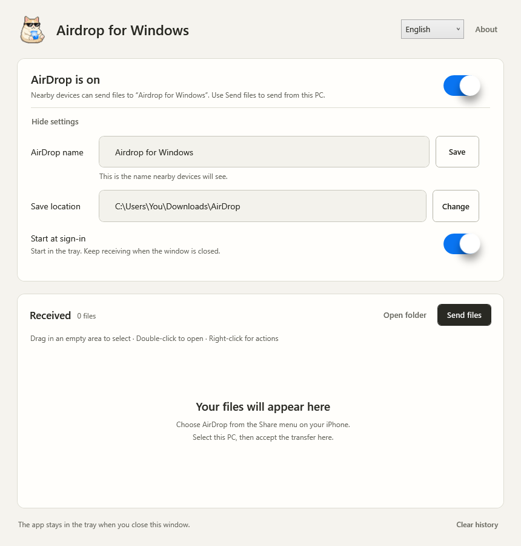
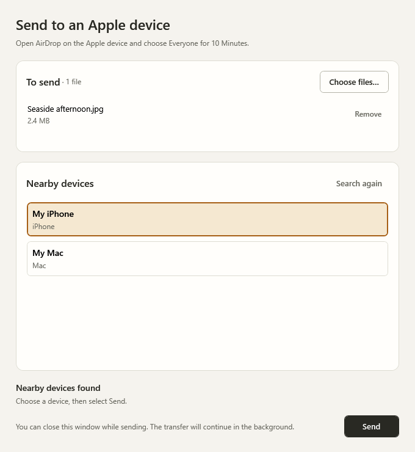

[简体中文](README.md) | **English**

<div align="center">


# Airdrop for Windows

**Send and receive files with AirDrop on Windows.**

By **Dy1an-Zou** · **0.2.5 experimental preview**

[Features](#features) · [Installer](#installer) · [How to use](#how-to-use) · [Hardware requirements](#hardware-requirements) · [Development and builds](#development-and-builds) · [Credits and licenses](#credits-and-licenses)

</div>

> [!IMPORTANT]
> **0.2.5 clears successfully sent files from the queue and adds file drag and drop in both directions.**
> Separate MT7925 and RTL8852CE installers require the matching experimental driver to be configured first.
> **RTL8852CE is still untested on hardware. Hardware support is unchanged.**
> [0.2.5 downloads and bilingual release notes](https://github.com/Dy1an-Zou/Airdrop-for-Windows/releases/tag/v0.2.5) · [Hardware guide](docs/HARDWARE.md) · [RTL8852CE setup](docs/RTL8852CE.md)

Move photos from your phone to your PC, or send files from your PC to your iPhone. Once enabled, the app stays in the system tray. Open its window whenever you want to accept a transfer, manage received files, or send something.

## Features

| Feature | What it does |
| --- | --- |
| Receive files | Choose your PC in the iPhone share sheet, then accept the transfer in the Windows app. |
| Send files | Select local files and a nearby device. Transfer begins after the recipient accepts; you can follow its progress or cancel. The receiving device tested so far is an iPhone. |
| File drag and drop | Drop files from Explorer to queue them; drag received files into applications that accept file drops. Successful transfers remove their batch from the queue; failures and cancellation keep it. |
| Device name and save location | Set the name nearby devices see and the folder where received files are saved. |
| System tray and startup | Start hidden at sign-in and keep running in the tray after closing the window. |
| File management | Drag a selection rectangle from empty space, use Ctrl / Shift for multiple selection or Ctrl+A to select all, and scroll automatically near the edges. Right-click to open, locate, copy, remove a record, or move a file to the Recycle Bin. |
| Connection status | See the actual startup steps as they run. Switches include animated transitions. |
| Chinese and English interface | Switch languages immediately and keep your preference. Status and help text update with it; your file names stay unchanged. |

Removing a record or clearing the history only changes the list; the original files remain. Moving files to the Recycle Bin requires confirmation. If the destination does not support the Recycle Bin, the app keeps the files instead of permanently deleting them.

## Interface preview

These are off-screen renders of the actual 0.2.3 WPF interface with sample files and device names. The header language selector and both language layouts have been checked. Real-device testing is described under “What has been verified” below.

**Main window**



**Send window**



## Installer

[Download 0.2.5](https://github.com/Dy1an-Zou/Airdrop-for-Windows/releases/tag/v0.2.5) and choose the package for your dedicated adapter:

| Package | Hardware and verification scope |
| --- | --- |
| `Airdrop-for-Windows-0.2.5-MT7925-Setup-x64.exe` | Exact ID `PCI\VEN_14C3&DEV_7925&SUBSYS_60001A3B&REV_00`. Historical image transfers succeeded in both directions; the local 0.2.5 update and receiver startup after reboot were confirmed. |
| `Airdrop-for-Windows-0.2.5-RTL8852CE-Preview-Setup-x64.exe` | `PCI\VEN_10EC&DEV_C852`. Native components are unchanged from 0.2.4; **still untested on hardware**. [Prerequisites](docs/RTL8852CE.md). |
| `Airdrop-for-Windows-0.2.5-Source.zip` | Project sources, tests and four pinned corresponding-source archives for the RTL upstream components. |

Checksums and a validation record are included. **Cross-backend upgrades are rejected.**

Setup deploys the app and runtime files. It does not install drivers, change test-signing or other security settings, or restart Windows. Exit the app from the tray before updating. Neither new EXE installer has fresh-PC installation or live uninstall acceptance.

See the [installation guide](docs/INSTALL.md#english) for prerequisites, accepted upgrades, data preservation and removal.

## How to use

These steps assume the dedicated adapter, driver, and complete runtime environment are already configured.

### iPhone → Windows

1. Open Airdrop for Windows, enable the connection, and choose a device name and save location.
2. Enable Wi-Fi and Bluetooth on the iPhone, select a photo or file, and choose **Share → AirDrop**.
3. Select the PC, then choose **Accept (接收)** in the Windows app. The file appears in the received-files list when the transfer finishes.

### Windows → iPhone

1. Enable Wi-Fi and Bluetooth on the iPhone, set AirDrop to **Everyone for 10 Minutes**, and keep the device unlocked.
2. In the Windows app, choose **Send files (发送文件)**, add your files, and select the discovered iPhone.
3. Choose **Send (发送)** and accept the transfer on the iPhone. The window displays the transfer status.

If the device does not appear, keep its AirDrop screen open and search again. Closing the main window hides the app in the system tray. To stop it completely, choose **Exit (退出)** from the tray menu.

## What has been verified

- **0.2.5 implementation checks:** 34 file-interaction checks, 10 UI checks and 3 language checks passed. Packaged application checks include a local HTTPS/CPIO file-transfer loopback; all 3 targeted outgoing-queue fault variants were detected. Both installers have embedded-file and matching-backend upgrade checks.
- **MT7925:** historical iPhone-to-Windows photo reception and Windows-to-iPhone single-image transfer were confirmed separately. The local installation was updated to 0.2.5 and its driver and receiver started after reboot. Phone transfers and actual drops into Codex or other applications were not repeated this round.
- **RTL8852CE:** no physical adapter is available. Discovery, transfers, actual installation, shutdown/restart and sleep/wake remain untested.

MT7925 buffer allocation failed during this round; a later reboot exposed Code 52 because test signing was inactive. Restoring test signing and rebooting recovered service startup. This release does not fix the underlying allocation issue.

Dropping folders, Contacts Only, verification-code pairing and 30-day temporary contacts are not supported. Coverage of Apple models, OS versions, file types and long-running stability is incomplete.

See the [0.2.5 bilingual release notes](docs/releases/v0.2.5.md), [historical RTL validation record](docs/RTL8852CE-VALIDATION.md) and [build guide](docs/BUILD.md).

## Hardware requirements

**RTL8852CE:** a dedicated PCIe `10EC:C852` adapter, Windows 11 x64 build 26100+, and the pinned upstream experimental driver and required privileges. See the [RTL8852CE guide](docs/RTL8852CE.md) for all prerequisites. This release does not add support for RTL8852AE, RTL8852BE, Realtek USB, Intel, or Broadcom adapters.

**MT7925:**

- **Windows x64**; the current driver INF requires **build 26100 or later**.
- A **dedicated MediaTek MT7925 PCIe adapter** matching `PCI\VEN_14C3&DEV_7925&SUBSYS_60001A3B&REV_00`.
- The experimental driver, matching wireless backend and Wintun virtual interface, and a driver test-signing environment configured by the developer.

While running the experimental driver, this dedicated adapter does not provide a normal Wi-Fi internet connection. The verified configuration uses 2.4 GHz channel 6. Support has not been established for other hardware, channels, or system configurations.

The source repository does not contain signed drivers, signing certificates, private keys, firmware, or a Python runtime. Building the desktop window does not configure the wireless environment automatically. See [hardware and runtime requirements](docs/HARDWARE.md) (Chinese).

## Development and builds

On Windows x64 with .NET SDK 10, build the desktop component with:

```powershell
dotnet build .\app\XiatiaoAirDrop.csproj -c Release
```

A working installation also needs the protocol engine, wireless backend, firmware, and matching driver. See [BUILD.md](docs/BUILD.md) for build instructions, and [DEPENDENCIES.json](docs/DEPENDENCIES.json) and [PROVENANCE.json](docs/PROVENANCE.json) for component versions and origins.

| Directory | Contents |
| --- | --- |
| `app/` | Windows interface, system tray, wireless helper, packaging scripts, and UI assets. |
| `airdrop/` | Python device discovery, file reception, and sending engine. |
| `awdl/`, `radio/`, `driver/mt7925/` | AWDL protocol support, the userspace radio process, and the experimental MT7925 driver. |
| `upstream/owl/` | The OWL and Radiotap source used by the project. |
| `artwork/` | Editable, layered source for the approved icon. |
| `docs/` | Build, hardware, provenance, and dependency documentation. |

Settings, transfer history, and runtime identity files are stored in `%LOCALAPPDATA%\XiatiaoAirDrop` and are not part of the source repository. Received files are saved to the folder selected by the user.

## Credits and licenses

This project builds on the work of these projects and authors:

| Project | Contribution |
| --- | --- |
| [winawdl · Raphaël Richaud](https://github.com/raph559/winawdl) | Windows AirDrop foundations and sending code. |
| [OWL · SEEMOO / TU Darmstadt](https://github.com/seemoo-lab/owl) | AWDL protocol implementation. |
| [omdrop · Brent Kearney](https://github.com/brentkearney/omdrop-plugin) | AirDrop reception engine. |
| [mt76 · OpenWrt / MediaTek](https://github.com/openwrt/mt76) | Reference implementation for the MT7925 port. |
| [Uiverse / Galaxy](https://github.com/uiverse-io/galaxy) | UI components. Original materials, author credits, and licenses are retained in `app/design-sources/` and `app/licenses/`. |

Desktop integration and this project's modifications are by **Dy1an-Zou**. Components are separately licensed under MIT, GPL-2.0-only, GPL-3.0-or-later, BSD-3-Clause-Clear, ISC, and other applicable licenses. The desktop code's MIT license does not cover the entire repository. See [LICENSE](LICENSE) and the [third-party notices](app/licenses/THIRD-PARTY-NOTICES.md) for the license map and original author credits.

AirDrop, Apple, iPhone, and Mac are trademarks of Apple Inc. This is an independent third-party project, with no affiliation, sponsorship, or endorsement from Apple Inc. Artwork and trademarks are not covered by the code's MIT license. See [ARTWORK.md](app/design-sources/ARTWORK.md) for asset provenance.
