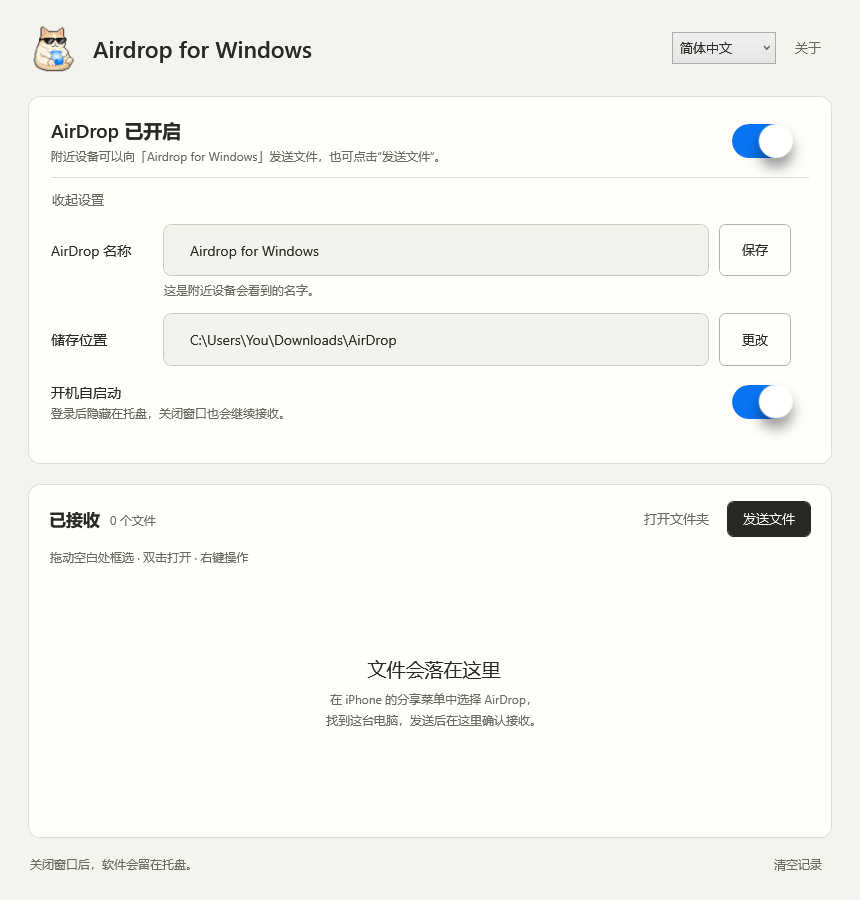
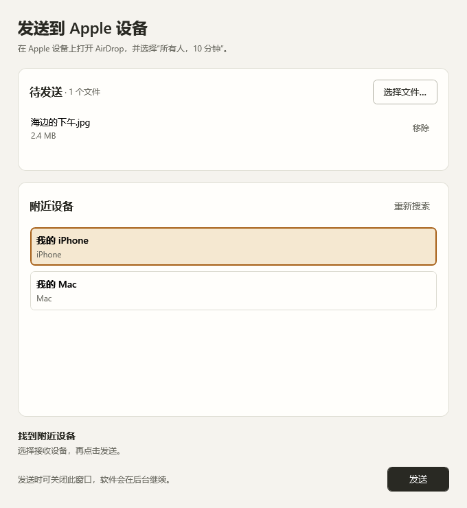

**简体中文** | [English](README.en.md)

<div align="center">


# Airdrop for Windows

**在 Windows 上，用熟悉的 AirDrop 收发文件。**

作者 **Dy1an-Zou** · **0.2.5 实验预览版**

[功能](#能做什么) · [安装包](#安装包) · [使用方式](#怎么用) · [硬件要求](#需要什么硬件) · [开发与构建](#开发与构建) · [来源与许可](#来源与许可)

</div>

> [!IMPORTANT]
> **0.2.5：发送成功后清理队列，支持从资源管理器拖入文件、从已接收列表拖出文件。**
> 安装包按 MT7925 / RTL8852CE 分开提供，均需要提前配置对应实验驱动。
> **RTL8852CE 仍未实机验证，硬件支持范围没有扩大。**
> [0.2.5 下载与中英发布说明](https://github.com/Dy1an-Zou/Airdrop-for-Windows/releases/tag/v0.2.5) · [硬件说明](docs/HARDWARE.md) · [RTL8852CE 准备指南](docs/RTL8852CE.md)

把手机里的照片传到电脑，或把电脑里的文件发回 iPhone。打开连接后，软件会留在托盘里；需要时打开窗口，查看来件、管理收到的文件，或选择文件发送。

## 能做什么

| 功能 | 使用体验 |
| --- | --- |
| 接收文件 | 在 iPhone 分享菜单中选择电脑，在 Windows 窗口里确认接收。 |
| 发送文件 | 选择本机文件和附近设备，对方同意后开始传输，可查看进度或取消。当前实测接收端为 iPhone。 |
| 文件拖放 | 从资源管理器拖入待发送文件；将单个或多选已接收文件拖到支持文件拖放的应用。成功发送后自动移除本次队列，失败或取消保留。 |
| 自定义名称与保存位置 | 设置附近设备看到的名称，以及收到文件的存放文件夹。 |
| 托盘与自启动 | 登录时隐藏启动；关闭窗口后继续在托盘运行。 |
| 文件管理 | 从空白处拖动框选，支持 Ctrl / Shift 多选、Ctrl+A 全选和边缘自动滚动；右键打开、定位、复制、移除记录或移到回收站。 |
| 运行状态 | 显示连接开启过程中的实际阶段，开关带过渡动画。 |
| 中英界面 | 支持中文 / English 即时切换并保存偏好，状态与提示随之更新，用户文件名保持原样。 |

「移除记录」和「清空记录」只整理列表，原文件会保留。「移到回收站」会再次确认；不支持回收站的位置不会退回永久删除。

## 界面预览

以下为 0.2.3 实际 WPF 界面的离屏渲染，使用示例文件及设备名称。顶栏语言选择器和中英布局已检查；真实传输的验证范围见下方「已验证到哪一步」。

**主窗口**



**发送窗口**



## 安装包

[下载 0.2.5](https://github.com/Dy1an-Zou/Airdrop-for-Windows/releases/tag/v0.2.5)，按专用网卡选择安装包：

| 安装包 | 网卡与验证范围 |
| --- | --- |
| `Airdrop-for-Windows-0.2.5-MT7925-Setup-x64.exe` | 精确匹配 `PCI\VEN_14C3&DEV_7925&SUBSYS_60001A3B&REV_00`。已有双向图片传输历史，0.2.5 本机更新及重启后服务启动已确认。 |
| `Airdrop-for-Windows-0.2.5-RTL8852CE-Preview-Setup-x64.exe` | `PCI\VEN_10EC&DEV_C852`。沿用 0.2.4 原生组件，**仍未实机验证**。[准备条件](docs/RTL8852CE.md)。 |
| `Airdrop-for-Windows-0.2.5-Source.zip` | 项目源码、测试和四份固定版本的 RTL 上游对应源码归档。 |

同时提供 SHA-256 校验和验证记录。**不能跨网卡后端覆盖升级。**

安装包部署应用及配套运行文件，不安装网卡驱动、不改变测试签名或其他系统安全设置、不自动重启。更新前从托盘正常退出软件。新 EXE 安装器未做新电脑安装或真实卸载验收。

完整准备条件、更新范围、数据保留和卸载步骤见 [安装与卸载](docs/INSTALL.md)。

## 怎么用

以下操作适用于已经配置好专用网卡、驱动和完整运行环境的电脑。

### iPhone → Windows

1. 打开 Airdrop for Windows，开启连接，设置电脑名称和保存位置。
2. 在 iPhone 上开启 Wi-Fi 和蓝牙，选择照片或文件，点「分享 → AirDrop」。
3. 选择电脑，在 Windows 的来件栏点「接收」。完成后，文件会出现在下方列表。

### Windows → iPhone

1. 在 iPhone 上开启 Wi-Fi 和蓝牙，将 AirDrop 设为「所有人，10 分钟」，保持设备解锁。
2. 在 Windows 软件中点「发送文件」，添加文件并选择发现的 iPhone。
3. 点「发送」，在 iPhone 上同意接收。窗口会显示传输状态。

找不到设备时，可以保持 iPhone 的 AirDrop 页面打开，再重新搜索。关闭软件主窗口会隐藏到托盘；需要完全停止时，在托盘菜单中选择退出。

## 已验证到哪一步

- **0.2.5 实施检查：**34 项文件交互、10 项界面、3 项语言检查通过；随包应用检查包括本机 HTTPS/CPIO 文件回环；3 个发送队列错误变体全部检出。两种安装包均核验内嵌文件及对应后端升级约束。
- **MT7925：**此前已分别确认 iPhone → Windows 照片接收和 Windows → iPhone 单张图片发送。本机已更新到 0.2.5，重启后确认驱动及接收服务启动；本轮未重做手机传输，也未实际拖入 Codex 等外部应用。
- **RTL8852CE：**没有实物，发现、双向收发、实际安装、关闭重开、睡眠恢复均未验证。

本轮曾遇到 MT7925 缓冲区分配失败，随后重启又出现测试签名未生效造成的 Code 52。恢复测试签名并重启后服务恢复；本版没有修复底层分配问题。

尚不支持拖入文件夹、「仅限联系人」、验证码配对和 30 天临时联系人。所有 Apple 型号、系统版本、文件类型及长期稳定性没有全面验证。

详见 [0.2.5 中英发布说明](docs/releases/v0.2.5.md)、[RTL 历史验证记录](docs/RTL8852CE-VALIDATION.md) 和 [构建说明](docs/BUILD.md)。

## 需要什么硬件

**RTL8852CE：**专用 PCIe `10EC:C852`，Windows 11 x64 build 26100+，以及指定的上游实验驱动和权限。完整条件见 [RTL8852CE 说明](docs/RTL8852CE.md)。RTL8852AE、RTL8852BE、Realtek USB、Intel 和 Broadcom 网卡不在本次新增支持范围内。

**MT7925：**

- **Windows x64**；当前驱动 INF 的最低系统构建为 **26100**。
- **专用 MediaTek MT7925 PCIe**，匹配 `PCI\VEN_14C3&DEV_7925&SUBSYS_60001A3B&REV_00`。
- 实验驱动、对应版本的无线后端与 Wintun 虚拟接口，以及自行配置的驱动测试签名环境。

这块专用网卡运行实验驱动时不承担普通 Wi-Fi 联网。已验证组合使用 2.4 GHz 信道 6；其他硬件、信道和系统组合未声明支持。

源码不包含已签名驱动、签名证书、私钥、固件或 Python 运行时。构建桌面窗口也不会自动完成无线环境配置。具体要求见 [硬件与运行边界](docs/HARDWARE.md)。

## 开发与构建

使用 Windows x64 和 .NET SDK 10，可先构建桌面部分：

```powershell
dotnet build .\app\XiatiaoAirDrop.csproj -c Release
```

完整运行还需要协议引擎、无线后端、固件和对应驱动。详细入口见 [BUILD.md](docs/BUILD.md)，组件版本与来源见 [DEPENDENCIES.json](docs/DEPENDENCIES.json) 和 [PROVENANCE.json](docs/PROVENANCE.json)。

| 目录 | 内容 |
| --- | --- |
| `app/` | Windows 窗口、托盘、无线助手、打包脚本和界面资源。 |
| `airdrop/` | Python 文件发现、接收与发送引擎。 |
| `awdl/`、`radio/`、`driver/mt7925/` | AWDL 协议、用户态无线进程与 MT7925 实验驱动。 |
| `upstream/owl/` | 使用到的 OWL 与 Radiotap 源码。 |
| `artwork/` | 已确认图标的可编辑分层原稿。 |
| `docs/` | 构建、硬件、来源与依赖说明。 |

设置、历史记录和运行时身份保存在 `%LOCALAPPDATA%\XiatiaoAirDrop`，不属于源码仓库。接收文件保存在用户选择的位置。

## 来源与许可

感谢这些项目与作者提供基础工作：

| 项目 | 用途 |
| --- | --- |
| [winawdl · Raphaël Richaud](https://github.com/raph559/winawdl) | Windows AirDrop 基础与发送代码。 |
| [OWL · SEEMOO / TU Darmstadt](https://github.com/seemoo-lab/owl) | AWDL 协议实现。 |
| [omdrop · Brent Kearney](https://github.com/brentkearney/omdrop-plugin) | AirDrop 接收引擎。 |
| [mt76 · OpenWrt / MediaTek](https://github.com/openwrt/mt76) | MT7925 移植参考。 |
| [Uiverse / Galaxy](https://github.com/uiverse-io/galaxy) | 界面组件；原始素材、作者与许可保存在 `app/design-sources/` 和 `app/licenses/`。 |

桌面整合及本项目修改作者为 **Dy1an-Zou**。仓库内各组件分别遵循 MIT、GPL-2.0-only、GPL-3.0-or-later、BSD-3-Clause-Clear、ISC 等许可；桌面代码的 MIT 授权不覆盖整个仓库。完整对应关系与原作者署名见 [LICENSE](LICENSE) 和 [第三方说明](app/licenses/THIRD-PARTY-NOTICES.md)。

AirDrop、Apple、iPhone 和 Mac 是 Apple Inc. 的商标。项目为独立第三方实现，与 Apple Inc. 无隶属、赞助或认可关系。图形与商标不包含在代码的 MIT 授权中，素材来源见 [ARTWORK.md](app/design-sources/ARTWORK.md)。
